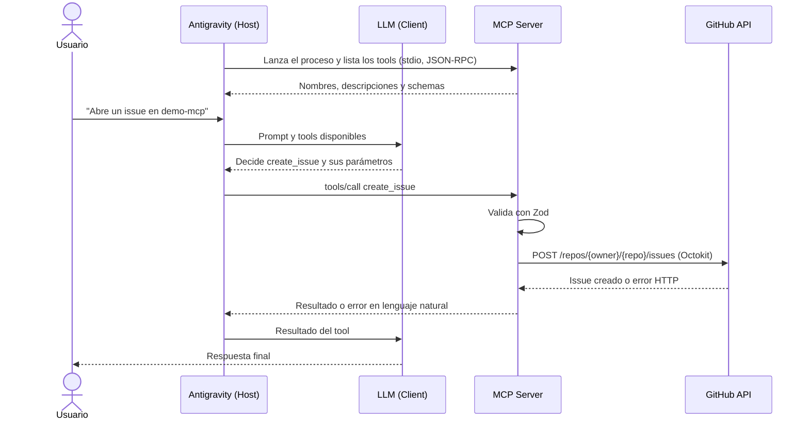

# GitHub MCP Server

Servidor [Model Context Protocol](https://modelcontextprotocol.io) en Node.js y TypeScript que permite a un agente de IA operar GitHub mediante lenguaje natural. Se conecta a [Antigravity](https://antigravity.google) por stdio y funciona con cualquier LLM que el host soporte.

```text
"Crea una rama feat/docs en mi repo demo, agrega docs/guia.md y abre un pull request"
```

A partir de ese pedido, el agente elige los tools `create_branch`, `create_commit` y `create_pull_request`, los ejecuta en orden y devuelve el enlace al pull request.

## Por qué es útil

- **Tareas repetitivas sin cambiar de contexto:** crear issues, ramas o pull requests desde el chat del IDE.
- **Triage conversacional:** "¿qué issues abiertos tiene el repo api?" y cerrar los que ya están resueltos.
- **Arranque de proyectos:** crear un repositorio y su primera documentación con un solo pedido.
- **Seguimiento rápido:** "¿qué cambió esta semana en main?".
- **Diagnóstico guiado:** los errores llegan en lenguaje natural, por lo que el agente puede explicar qué pasó y cómo seguir.

## Requisitos

| Requisito | Versión o detalle |
|---|---|
| Node.js | 22.12 o superior |
| npm | Incluido con Node.js |
| Antigravity | Con sesión iniciada y un modelo disponible |
| GitHub | Cuenta con un Personal Access Token |

> La consigna parte de Node 18, pero las versiones actuales de las dependencias exigen más: `@octokit/rest` necesita Node 20 y Vitest, Node 22.12.

## Instalación

```bash
git clone https://github.com/rominababiel/github-mcp-server.git
cd github-mcp-server
npm install
npm run build
```

`npm run build` compila TypeScript en `dist/`, que es lo que ejecuta Antigravity.

## Configuración

### 1. Obtener un GitHub Personal Access Token

1. Abre [github.com/settings/tokens/new](https://github.com/settings/tokens/new) para crear un token **classic**.
2. Escribe un nombre, como `github-mcp-server`, y elige una fecha de vencimiento.
3. Selecciona los scopes de la tabla siguiente.
4. Haz clic en **Generate token** y copia el valor. GitHub no lo vuelve a mostrar.

### 2. Scopes del token

| Scope | Para qué se usa |
|---|---|
| `repo` | Repositorios, issues, commits, ramas y pull requests, públicos y privados |
| `user` | Información del usuario autenticado |
| `admin:org` | Operaciones sobre organizaciones |

`admin:org` da permisos amplios. Si no vas a trabajar con organizaciones, puedes omitirlo; `health_check` lo informará como faltante, pero los demás tools seguirán funcionando en tus repositorios.

### 3. Configurar `.env`

```bash
cp .env.example .env
```

En Windows con PowerShell, usa `Copy-Item .env.example .env`. Luego completa el token:

```dotenv
GITHUB_TOKEN=tu_token
LOG_LEVEL=info
```

`.env` está en `.gitignore` y no debe subirse nunca. Si un token llega al repositorio, **revócalo de inmediato**: seguirá en el historial aunque borres el archivo después.

### 4. Configurar el server en Antigravity

1. En el panel del agente, abre el menú **…** y entra en **MCP Servers**.
2. Elige **Manage MCP Servers** y luego **View raw config**.
3. Agrega el server a `mcp_config.json`, con la ruta absoluta a `dist/server.js`:

```json
{
  "mcpServers": {
    "github": {
      "command": "node",
      "args": ["C:/ruta/a/github-mcp-server/dist/server.js"]
    }
  }
}
```

4. Guarda el archivo y actualiza la lista de servers. Deben aparecer los 10 tools.

El server encuentra su `.env` por su propia ubicación, sin importar desde qué carpeta lo lance Antigravity. Si prefieres no usar `.env`, agrega el token en la configuración; esa variable tiene prioridad:

```json
"env": { "GITHUB_TOKEN": "tu_token" }
```

### 5. Verificar la instalación

Pídele al agente:

```text
Verifica la conexión con GitHub.
```

`health_check` debe responder con tu usuario, los scopes del token y el rate limit disponible.

## Tools

Los campos con valor por defecto o marcados como opcionales pueden omitirse.

### Tools principales

#### `create_repository`

Crea un repositorio en la cuenta personal o en una organización.

| Parámetro | Tipo | Detalle |
|---|---|---|
| `name` | `string` | 3 a 100 caracteres: letras, números y guiones |
| `description` | `string` opcional | Hasta 350 caracteres, en una línea |
| `private` | `boolean` | Por defecto `false` |
| `autoInit` | `boolean` | Crea un README inicial. Por defecto `true` |
| `organization` | `string` opcional | Si se omite, se usa la cuenta personal |

> **Prompt:** Crea un repositorio privado llamado `api-pagos` con la descripción "API de pagos".

#### `list_repositories`

Lista los repositorios a los que accede el usuario, por actividad reciente.

| Parámetro | Tipo | Detalle |
|---|---|---|
| `visibility` | `"all" \| "public" \| "private"` | Por defecto `all` |
| `limit` | `number` | 1 a 100. Por defecto 30 |

> **Prompt:** Muéstrame mis 5 repositorios privados más recientes.

#### `create_issue`

Abre un issue en un repositorio.

| Parámetro | Tipo | Detalle |
|---|---|---|
| `owner` | `string` | Usuario u organización dueña |
| `repo` | `string` | Nombre del repositorio |
| `title` | `string` | 1 a 256 caracteres |
| `body` | `string` opcional | Markdown, hasta 65536 caracteres |

> **Prompt:** Abre un issue en `octocat/api-pagos` titulado "Error al procesar reembolsos" y explica que falla con montos en cero.

#### `list_issues`

Lista los issues abiertos de un repositorio, sin incluir pull requests.

| Parámetro | Tipo | Detalle |
|---|---|---|
| `owner` | `string` | Usuario u organización dueña |
| `repo` | `string` | Nombre del repositorio |
| `limit` | `number` | 1 a 100. Por defecto 30 |

> **Prompt:** ¿Qué issues abiertos tiene `octocat/api-pagos`?

#### `create_commit`

Agrega o reemplaza un archivo de texto mediante un commit.

| Parámetro | Tipo | Detalle |
|---|---|---|
| `owner` | `string` | Usuario u organización dueña |
| `repo` | `string` | Nombre del repositorio |
| `path` | `string` | Ruta relativa a la raíz, como `docs/guia.md` |
| `content` | `string` | Contenido final completo, hasta 1.000.000 de caracteres |
| `message` | `string` | Mensaje del commit |
| `branch` | `string` opcional | Rama existente. Si se omite, se usa la rama por defecto |

> **Prompt:** En `octocat/api-pagos`, agrega `docs/guia.md` con un título "Guía" y una descripción breve. Usa el mensaje de commit "docs: add guide".

### Tools avanzados

#### `create_branch`

Crea una rama a partir de otra.

| Parámetro | Tipo | Detalle |
|---|---|---|
| `owner` | `string` | Usuario u organización dueña |
| `repo` | `string` | Nombre del repositorio |
| `branch` | `string` | Nombre de la rama nueva |
| `fromBranch` | `string` opcional | Si se omite, parte de la rama por defecto |

> **Prompt:** Crea la rama `feat/reembolsos` en `octocat/api-pagos`.

#### `create_pull_request`

Abre un pull request entre dos ramas del mismo repositorio.

| Parámetro | Tipo | Detalle |
|---|---|---|
| `owner` | `string` | Usuario u organización dueña |
| `repo` | `string` | Nombre del repositorio |
| `title` | `string` | 1 a 256 caracteres |
| `head` | `string` | Rama con los cambios |
| `base` | `string` opcional | Si se omite, apunta a la rama por defecto |
| `body` | `string` opcional | Descripción en Markdown |

> **Prompt:** Abre un pull request de `feat/reembolsos` hacia `main` en `octocat/api-pagos`, titulado "Corregir reembolsos".

#### `list_commits`

Lista los commits recientes de un repositorio o rama.

| Parámetro | Tipo | Detalle |
|---|---|---|
| `owner` | `string` | Usuario u organización dueña |
| `repo` | `string` | Nombre del repositorio |
| `branch` | `string` opcional | Si se omite, usa la rama por defecto |
| `limit` | `number` | 1 a 100. Por defecto 30 |

> **Prompt:** Muéstrame los últimos 3 commits de `octocat/api-pagos`.

#### `close_issue`

Cierra un issue. Rechaza el pedido si el número corresponde a un pull request.

| Parámetro | Tipo | Detalle |
|---|---|---|
| `owner` | `string` | Usuario u organización dueña |
| `repo` | `string` | Nombre del repositorio |
| `issueNumber` | `number` | Número del issue |
| `reason` | `"completed" \| "not_planned"` | Por defecto `completed` |

> **Prompt:** Cierra el issue #12 de `octocat/api-pagos` porque ya está resuelto.

#### `health_check`

Verifica la conexión e informa el usuario, los scopes concedidos y faltantes, y el rate limit. No recibe parámetros.

> **Prompt:** Verifica mi conexión con GitHub y dime si al token le falta algún permiso.

## Ejemplos de uso

Cada flujo combina tools, y juntos cubren los 10:

| Pedido | Tools que usa el agente |
|---|---|
| "Verifica la conexión con GitHub y lista mis 5 repositorios más recientes." | `health_check`, `list_repositories` |
| "Crea un repositorio llamado `demo-mcp`, abre un issue 'Agregar documentación' y muéstrame los issues abiertos." | `create_repository`, `create_issue`, `list_issues` |
| "En `demo-mcp`, crea la rama `feat/docs`, agrega `docs/guia.md` con una guía breve y abre un pull request hacia `main`." | `create_branch`, `create_commit`, `create_pull_request` |
| "Muéstrame los últimos commits de `demo-mcp` y cierra el issue de documentación." | `list_commits`, `close_issue` |
| "Crea un repositorio llamado `a b`." | Ninguna llamada a GitHub: la validación explica el error |

## Arquitectura



Según la especificación de MCP, el cliente es un componente del host que mantiene la conexión con el server; el LLM es quien decide qué tool usar a partir de sus descripciones.

### Capas

```text
src/
├── server.ts          Entry point: carga el entorno y conecta el transporte stdio
├── mcp-server.ts      Handlers del protocolo: listar y ejecutar tools
├── config.ts          Identidad del server, scopes y carga de .env
├── types.ts           Modelos de dominio que devuelven las operaciones
├── tools/             Un archivo por tool, más define-tool.ts
├── schemas/           Schemas de Zod y tipos inferidos
├── github/
│   ├── client.ts      Configuración de Octokit
│   └── operations.ts  Operaciones de GitHub
├── errors/            Tipos de error y traducción a lenguaje natural
└── utils/             Logging y reintentos
```

Las dependencias van en una sola dirección: `tools → schemas / operations → client`. Las operaciones no conocen MCP y los tools no llaman a Octokit directamente.

### Decisiones técnicas

| Decisión | Motivo |
|---|---|
| Stdio en lugar de HTTP | Es un proceso local del usuario: no abre puertos y el token no sale de su máquina |
| `Server` en lugar de `McpServer` | `McpServer` valida antes del handler y su error mezcla texto del SDK; así, toda validación pasa por `ValidationError` |
| Errores como resultado con `isError: true` | El LLM los puede leer y explicar; un fallo de protocolo no le daría esa oportunidad |
| Logs solo en stderr | Stdout transporta JSON-RPC y cualquier otra salida rompería la comunicación |
| Dos reglas para nombres de repositorio | Al crear se aplica la regla de la consigna; al referenciar, la de GitHub, para no bloquear repos como `mi_repo` |
| Reintentos según el tipo de error | El rate limit se reintenta siempre porque GitHub rechazó el pedido; los fallos de red solo en lecturas, para no duplicar escrituras |
| Contents API para commits | Permite el primer commit de un repositorio vacío y resuelve un archivo por operación |

## Manejo de errores

| Tipo | Cuándo ocurre | Ejemplo de mensaje |
|---|---|---|
| `ValidationError` | Input inválido, antes de llamar a GitHub | `Parámetros inválidos. name: El nombre del repositorio solo admite letras, números y guiones.` |
| `AuthenticationError` | Token ausente o inválido (401), falta de permisos (403) | `GitHub rechazó las credenciales. Verifica que GITHUB_TOKEN sea válido y no haya vencido.` |
| `GitHubAPIError` | 404, 409, 422, 5xx y rate limit | `El repositorio octocat/demo no fue encontrado. Verifica el nombre e intenta de nuevo.` |
| `NetworkError` | No se pudo conectar con GitHub | `No se pudo conectar con GitHub. Verifica tu conexión a internet e intenta de nuevo.` |
| `UnexpectedError` | Cualquier otro fallo | Mensaje genérico; el detalle queda en los logs |

**Rate limit:** se respetan `retry-after` y `x-ratelimit-reset`. Sin esos datos se aplica backoff exponencial con jitter, hasta 3 intentos. Si la espera supera los 30 segundos, no se bloquea al agente: se informa cuándo reintentar.

**Logs:** se escriben en stderr como JSON, en los niveles `debug`, `info`, `warn` y `error`. Las claves sensibles y los valores con formato de token de GitHub se ocultan. Para más detalle, usa `LOG_LEVEL=debug` o `npm run dev`, que activa `--verbose`.

## Tests

```bash
npm test
```

Los tests usan Octokit mockeado y timers simulados: no hacen llamadas reales y son deterministas.

| Archivo | Qué verifica |
|---|---|
| `tests/tools.test.ts` | Schemas: inputs válidos, inválidos y sus mensajes |
| `tests/github.test.ts` | Operaciones con Octokit mockeado y casos edge |
| `tests/errors.test.ts` | Clasificación y traducción de errores |
| `tests/retry.test.ts` | Backoff, límite de espera y reintentos seguros |
| `tests/logging.test.ts` | Uso de stderr, niveles y ocultamiento del token |
| `tests/server.test.ts` | Flujo MCP completo con un cliente en memoria |

## Scripts

| Script | Función |
|---|---|
| `npm run build` | Compila TypeScript en `dist/` |
| `npm run dev` | Ejecuta desde el código fuente con logs detallados |
| `npm start` | Ejecuta la versión compilada |
| `npm test` | Ejecuta los tests |
| `npm run lint` | Ejecuta ESLint |
| `npm run typecheck` | Verifica los tipos sin compilar |
| `npm run inspect` | Abre MCP Inspector con la versión compilada |

Para depurar sin Antigravity:

```bash
npm run build
npm run inspect
```

## Troubleshooting

| Síntoma | Causa probable | Solución |
|---|---|---|
| `No se encontró GITHUB_TOKEN` | Falta `.env` o está vacío | Revisa el paso 3 de la configuración |
| `GitHub rechazó las credenciales` | Token inválido o vencido | Genera uno nuevo y actualiza `.env` |
| `El token no tiene permisos` | Faltan scopes o acceso a la organización | Ejecuta `health_check` y revisa `missingScopes` |
| Un repo privado da "no fue encontrado" | GitHub responde 404 si el token no tiene acceso | Verifica el dueño, el nombre y el scope `repo` |
| Antigravity no muestra los tools | Ruta incorrecta o falta compilar | Usa una ruta absoluta a `dist/server.js` y ejecuta `npm run build` |
| Los cambios de código no se reflejan | Antigravity usa `dist/` | Ejecuta `npm run build` y actualiza los servers |
| `list_issues` no muestra un cambio reciente | El listado de GitHub puede demorar unos segundos | Espera un momento y vuelve a consultar |
| `create_branch` indica que el repo está vacío | No hay commits de los que partir | Crea uno con `create_commit` |
| El server se desconecta al arrancar | Salida ajena al protocolo en stdout | Usa `logger`, nunca `console.log` |

## Licencia

[MIT](LICENSE)
